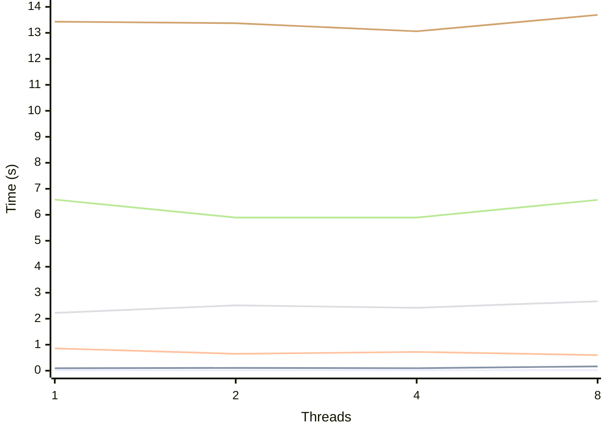
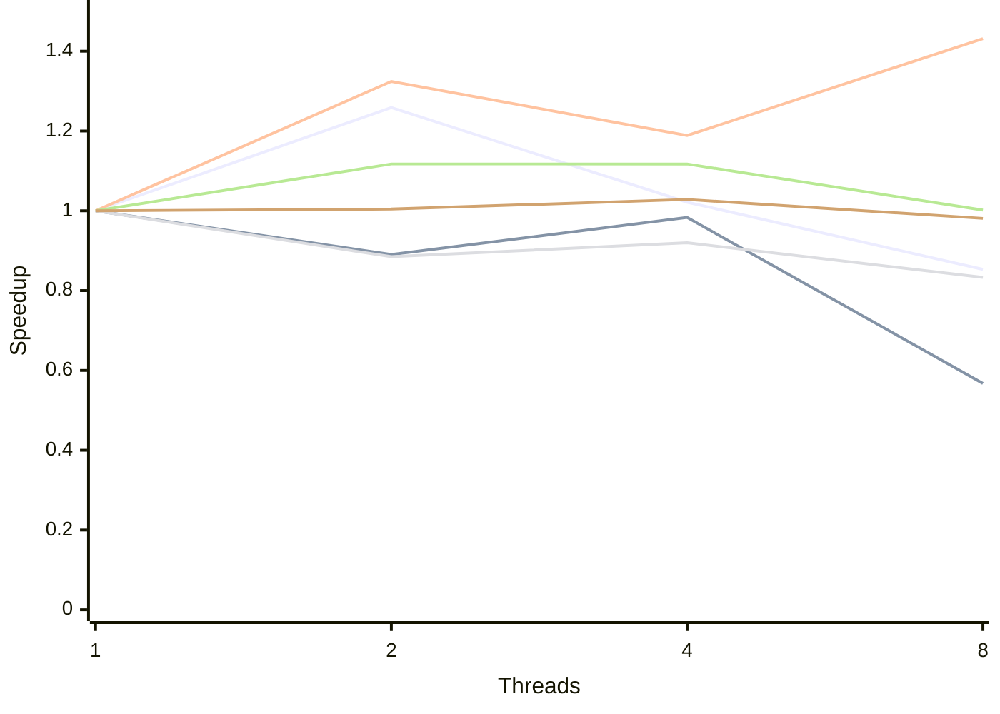

# Лабораторная работа №2

## Параллельное умножение квадратных матриц на C++ с использованием OpenMP

Программа предназначена для параллельного перемножения двух квадратных матриц. Реализация выполнена на языке C++ с использованием технологии OpenMP.

Проект позволяет исследовать зависимость времени выполнения и ускорения алгоритма от размера входных матриц и количества используемых потоков.

## Структура проекта

```text
parallel-programming/
│
├── lab2/
│   ├── results.txt       # Результаты измерений
│   ├── main.cpp          # Основная программа на C++ с OpenMP
│   ├── CMakeLists.txt    # Конфигурация сборки
│   └── README.md
│
├── CMakeLists.txt
├── CMakePresets.json
├── .gitignore
└── README.md
```

## Исследование производительности

Для исследования производительности используются квадратные матрицы следующих размеров: 100, 200, 400, 600, 800 и 1000.

Количество потоков для каждого размера матриц: 1, 2, 4 и 8.

Алгоритм работы:

1. Для каждого размера создаются две матрицы A и B, заполненные псевдослучайными вещественными числами типа `double`.
2. Выполняется параллельное умножение матриц с использованием OpenMP.
3. Распределение вычислений между потоками выполняется с помощью директивы `#pragma omp parallel for`.
4. Для каждого количества потоков измеряется время выполнения умножения.
5. Рассчитывается ускорение относительно выполнения с одним потоком.
6. Полученные результаты записываются в файл `results.txt`.


## Результаты исследования

Ускорение параллельного алгоритма:

```text
S = T₁ / T
```

**Обозначения:**
- `T₁` — время выполнения с одним потоком;
- `T` — время выполнения с n потоками;
- `S` — коэффициент ускорения.

В ходе эксперимента были выполнены параллельные перемножения квадратных матриц различных размеров с использованием 1, 2, 4 и 8 потоков.

### Таблица результатов

| Matrix Size | Threads | Time (s) | Speedup |
|---|---:|---:|---:|
| **100 × 100** | 1 | 0.0160864 | 1 |
| | 2 | 0.0127796 | 1.25876 |
| | 4 | 0.0157475 | 1.02152 |
| | 8 | 0.0188541 | 0.853204 |
| **200 × 200** | 1 | 0.0944370 | 1 |
| | 2 | 0.1060520 | 0.890477 |
| | 4 | 0.0960387 | 0.983322 |
| | 8 | 0.1663800 | 0.567599 |
| **400 × 400** | 1 | 0.8588570 | 1 |
| | 2 | 0.6484810 | 1.32441 |
| | 4 | 0.7224120 | 1.18887 |
| | 8 | 0.5999360 | 1.43158 |
| **600 × 600** | 1 | 2.2246500 | 1 |
| | 2 | 2.5139600 | 0.884920 |
| | 4 | 2.4187300 | 0.919759 |
| | 8 | 2.6698700 | 0.833245 |
| **800 × 800** | 1 | 6.5838600 | 1 |
| | 2 | 5.8919500 | 1.11743 |
| | 4 | 5.8922100 | 1.11738 |
| | 8 | 6.5718900 | 1.00182 |
| **1000 × 1000** | 1 | 13.4300000 | 1 |
| | 2 | 13.3720000 | 1.00434 |
| | 4 | 13.0594000 | 1.02838 |
| | 8 | 13.6896000 | 0.981032 |

### График зависимости времени выполнения от количества потоков



### График зависимости ускорения от количества потоков



**Обозначения цветов на графиках:**
- Синяя линия — 100×100
- Зелёная линия — 200×200
- Красная линия — 400×400
- Жёлтая линия — 600×600
- Светло-серая линия — 800×800
- Белая линия — 1000×1000

### Анализ результатов

По результатам эксперимента можно сделать следующие выводы:

- При увеличении размера матриц время выполнения умножения значительно возрастает.
- Для небольших матриц использование нескольких потоков не обеспечивает ускорения из-за накладных расходов на параллельное выполнение.
- Наилучшее ускорение получено для матриц размером 400×400 при использовании 8 потоков — 1.43.
- Для больших матриц увеличение количества потоков не всегда приводит к сокращению времени выполнения.

Таким образом, эффективность параллельных вычислений зависит от размера матрицы и количества используемых потоков. Оптимальное количество потоков определяется экспериментально.