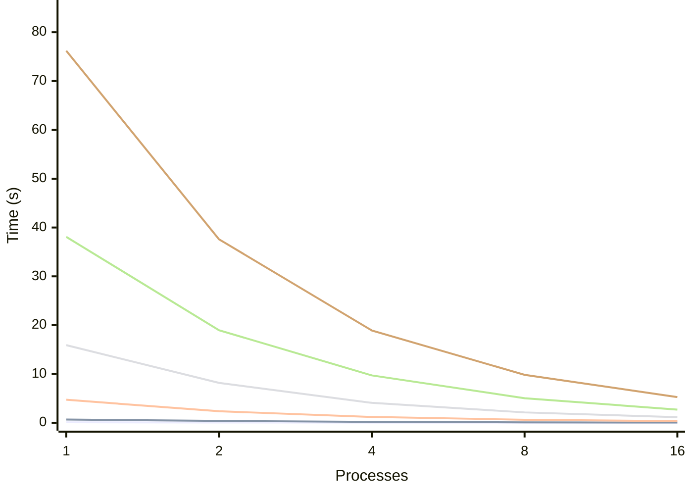
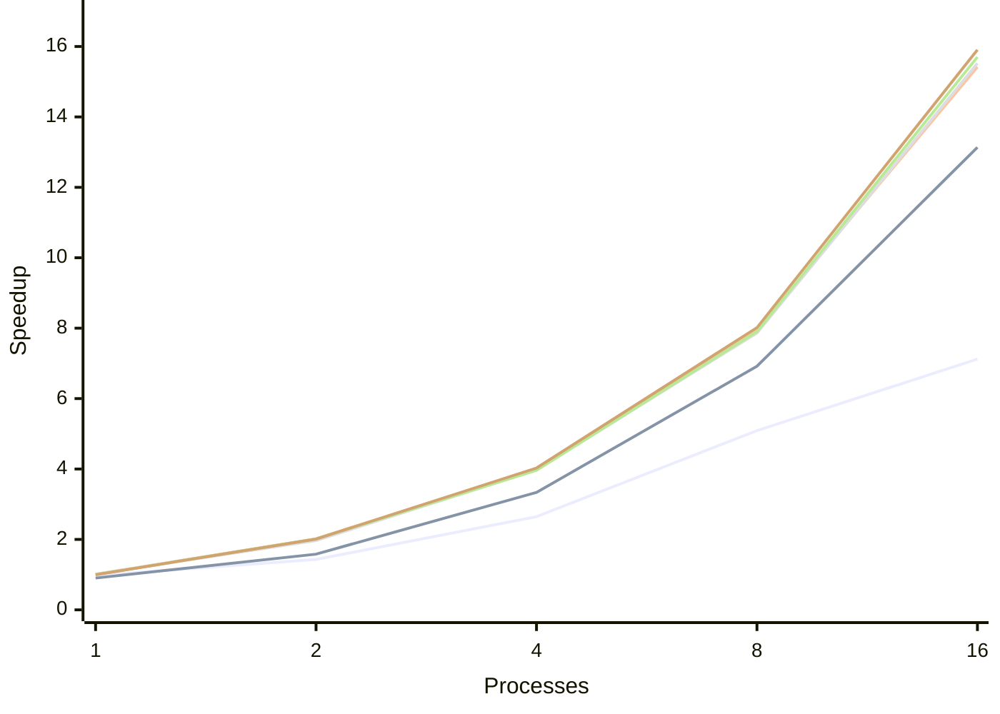

# Лабораторная работа №3

## Параллельное умножение квадратных матриц на C++ с использованием MPI

Программа предназначена для параллельного перемножения двух квадратных матриц. Реализация выполнена на языке C++ с использованием технологии MPI.

Проект позволяет исследовать зависимость времени выполнения и ускорения алгоритма от размера входных матриц и количества используемых MPI-процессов.

## Структура проекта

```text
parallel-programming/
│
├── lab3/
│   ├── results.txt       # Результаты измерений
│   ├── main.cpp          # Основная программа на C++ с MPI
│   ├── run_lab3.sh       # SLURM-скрипт для запуска программы
│   └── README.md
│
├── CMakeLists.txt
├── CMakePresets.json
├── .gitignore
└── README.md
```

## Исследование производительности

Для исследования производительности используются квадратные матрицы следующих размеров:

200, 400, 800, 1200, 1600 и 2000.

Количество MPI-процессов для каждого размера матриц:

1, 2, 4, 8 и 16.

### Алгоритм работы

1. Для каждого размера создаются две матрицы A и B, заполненные псевдослучайными вещественными числами типа `double`.
2. Матрица B рассылается всем MPI-процессам с помощью функции `MPI_Bcast`.
3. Строки матрицы A распределяются между процессами с помощью функции `MPI_Scatterv`.
4. Каждый процесс выполняет умножение своей части матрицы A на матрицу B.
5. Результаты собираются с помощью функции `MPI_Gatherv`.
6. Выполняется последовательное умножение матриц для сравнения результатов и измерения времени.
7. Рассчитывается ускорение параллельного алгоритма.
8. Полученные результаты записываются в файл `results.txt`.

## Результаты исследования

Ускорение параллельного алгоритма:

```text
S = T_sequential / T_parallel
```

**Обозначения:**
- `T_sequential` — время последовательного выполнения;
- `T_parallel` — время параллельного выполнения;
- `S` — коэффициент ускорения.

### Таблица результатов

| Matrix Size | Processes | Parallel Time (s) | Sequential Time (s) | Speedup |
|---|---:|---:|---:|---:|
| **200 × 200** | 1 | 0.0990109444 | 0.0965900421 | 0.97555 |
| | 2 | 0.0692028999 | 0.0990560055 | 1.43139 |
| | 4 | 0.0386340618 | 0.1022119522 | 2.64564 |
| | 8 | 0.0217649937 | 0.1108109951 | 5.09125 |
| | 16 | 0.0116500854 | 0.0829570293 | 7.12072 |
| **400 × 400** | 1 | 0.6626451015 | 0.5976378918 | 0.90190 |
| | 2 | 0.3837029934 | 0.6071000999 | 1.58221 |
| | 4 | 0.1922540665 | 0.6413099766 | 3.33574 |
| | 8 | 0.0979378223 | 0.6777440881 | 6.91705 |
| | 16 | 0.0504269600 | 0.6624770164 | 13.13736 |
| **800 × 800** | 1 | 4.7189459801 | 4.7689659595 | 1.01060 |
| | 2 | 2.3640668392 | 4.7700197697 | 2.01771 |
| | 4 | 1.2001180649 | 4.8207990524 | 4.01693 |
| | 8 | 0.6249179840 | 4.9599490166 | 7.93696 |
| | 16 | 0.3427479267 | 5.2844750881 | 15.41796 |
| **1200 × 1200** | 1 | 15.9070401192 | 16.0767810345 | 1.01067 |
| | 2 | 8.1708769798 | 16.0780289173 | 1.96772 |
| | 4 | 4.0853700638 | 16.2329502106 | 3.97343 |
| | 8 | 2.1283102036 | 16.7349729538 | 7.86303 |
| | 16 | 1.1482350826 | 17.8200130463 | 15.51984 |
| **1600 × 1600** | 1 | 38.0825660229 | 38.2161831856 | 1.00351 |
| | 2 | 18.9651610851 | 38.2155330181 | 2.01504 |
| | 4 | 9.7065210342 | 38.4872698784 | 3.96509 |
| | 8 | 5.0370349884 | 39.8088161945 | 7.90322 |
| | 16 | 2.7028129101 | 42.4366259575 | 15.70091 |
| **2000 × 2000** | 1 | 76.2023770809 | 75.9006860256 | 0.99604 |
| | 2 | 37.5918691158 | 75.5918951035 | 2.01086 |
| | 4 | 18.9169695615 | 76.1783070564 | 4.02698 |
| | 8 | 9.8251969814 | 78.7543351650 | 8.01555 |
| | 16 | 5.2654528618 | 83.7447230816 | 15.90456 |

### График зависимости времени выполнения от количества процессов



### График зависимости ускорения от количества процессов



**Обозначения цветов на графиках:**
- Синий — 200×200;
- Зеленый — 400×400;
- Красный — 800×800;
- Желтый — 1200×1200;
- Светло-серый — 1600×1600;
- Белый — 2000×2000.

### Анализ результатов

По результатам эксперимента можно сделать следующие выводы:

- При увеличении размера матриц значительно возрастает время выполнения умножения.
- Увеличение количества MPI-процессов приводит к сокращению времени параллельного выполнения.
- Для небольших матриц влияние накладных расходов заметнее, поэтому эффективность ниже.
- Наилучшее ускорение получено для матриц размером 2000 × 2000 при использовании 16 процессов — **15.9**.

Таким образом, эффективность параллельных вычислений с использованием MPI возрастает при увеличении количества процессов и размера матриц. Наиболее заметный эффект параллелизации наблюдается на больших матрицах.

## Запуск программы

Для выполнения экспериментов используется суперкомпьютер с поддержкой MPI и планировщик задач SLURM.

### Компиляция

Загрузка MPI-модуля и компиляция программы:

```bash
module load intel/mpi4
mpicxx main.cpp -o lab3_mpi
```

### Запуск экспериментов

Для автоматического запуска экспериментов используется SLURM-скрипт `script.pbs`.

Скрипт последовательно запускает программу с 1, 2, 4, 8 и 16 MPI-процессами.

Отправка задания в очередь:

```bash
sbatch run_lab3.sh
```

После завершения работы результаты сохраняются в файл `results.txt`.
